# User flows

## 1. First visit to first session

```mermaid
flowchart LR
  A[Landing] --> B[Sign up: Google or email]
  B --> C[Onboarding: name, avatar]
  C --> D[Onboarding: sex, age]
  D --> E[Onboarding: height, weight]
  E --> F[Today: empty state]
  F --> G[Create first workout]
  G --> H[Start session]
  H --> I[Log sets, rest timer]
  I --> J[Finish: summary]
```

A logged-in user who opens `/` goes straight to Today. The landing page is only for visitors without a session.

## 2. Build a workout

1. Library → Workouts → Create.
2. Name the workout.
3. Add exercises from the catalog (search, muscle filter). On desktop, drag from the catalog column.
4. For each exercise set target sets, reps (or time), weight and rest.
5. Reorder, remove, save.

## 3. Plan the calendar

1. Calendar → Schedule workout.
2. Pick a workout and a start date.
3. Choose "once" or "repeat weekly on …" with an optional end date.
4. Occurrences appear on the calendar.

## 4. Train in the gym (offline)

1. Open the installed app with no signal. Status shows Offline.
2. Today shows the planned workout from local data. Tap Start.
3. Log each set; the rest timer starts on check.
4. Equipment busy → Swap exercise → pick a suggestion → replace for today or in the workout.
5. Finish. Changes stay in the outbox; the pill shows the pending count.
6. Back online → the app syncs on open or on the `online` event. Pending count drops to zero.

## 5. Review progress

1. Calendar: days marked done, done late, missed, planned. Adherence for the month on top. Tap a day for the session details.
2. Progress: pick an exercise, see working weight and estimated 1RM over time, personal records.
3. Profile: BMI, weight trend, body measurements.

## 6. Share a workout

1. Workout → Share → create link (choose expiry) or export file.
2. Friend opens the link → sees a preview → logs in or signs up → Add to my library.
3. The workout and any custom exercises it uses are copied into the friend's account. Link owner can revoke it any time.

## 7. Substitute an exercise

1. In session, Swap exercise.
2. Pick a reason chip (busy, no equipment, discomfort).
3. See three suggestions with the shared muscles and required equipment.
4. Replace today only (set logs record `substitutedFrom`) or in the workout.
