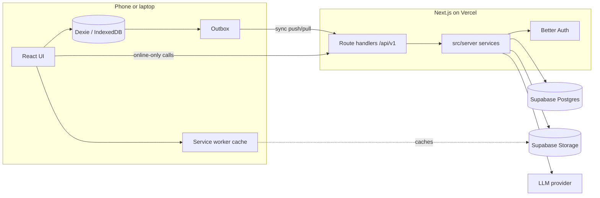

# Architecture

## Shape

One Next.js application deployed to Vercel. It serves the UI (React, App Router) and a versioned JSON API (route handlers under `src/app/api/v1`). Business logic lives in `src/server`, not in route handlers. Postgres and file storage come from Supabase. Auth is Better Auth running inside the app.

## Stack

| Concern | Choice | Notes |
| --- | --- | --- |
| Framework | Next.js (App Router), React, TypeScript strict | ADR 0002 |
| Styling | Tailwind CSS + shadcn/ui | Theme in `docs/tech/DESIGN_SYSTEM.md` |
| Server state | TanStack Query | ADR 0006 |
| UI state | Zustand | ADR 0006 |
| Forms | React Hook Form + Zod resolver | |
| Validation | Zod, shared by client and server | `src/shared/schemas` |
| Local data | Dexie (IndexedDB) | Spec 16, ADR 0005 |
| PWA | Web app manifest + service worker (Serwist or the current Next.js-supported option, decided in spec 15) | ADR 0001 |
| Database | Supabase Postgres + Drizzle ORM + drizzle-kit | ADR 0004 |
| Files | Supabase Storage | Exercise images and animations |
| Auth | Better Auth (email + password, Google) with the Drizzle adapter | ADR 0003 |
| Charts | Recharts (through shadcn charts) | |
| i18n | i18next + react-i18next, English source strings as keys | `docs/development/frontend/overview.md` |
| AI | Provider SDK on the server only, structured output via Zod | `docs/tech/AI.md` |
| Tests | Vitest (node + browser mode), Playwright e2e | `docs/development/*/testing.md` |
| CI/CD | GitHub Actions, Vercel previews | Spec 00 |

## Boundaries

- **Route handlers** parse and validate input, resolve the user, call one service function, map the result or error to HTTP. Nothing else. See `docs/development/backend/api-handlers.md`.
- **Services** (`src/server/<domain>/service.ts`) own business rules and always take the acting `userId`.
- **Queries** (`src/server/<domain>/queries.ts`) own SQL through Drizzle and are scoped by user.
- **Client** never talks to Postgres or Storage with privileged keys. Public exercise media is read through public Storage URLs.
- **Shared schemas** are the contract between client and server, and the export/import file format.

## Data flow

- **Online-only features** (workout builder, plan editing, sharing, AI, settings): TanStack Query calls the API.
- **Gym features** (Today, session, set logs, measurements, catalog reads): after spec 16 they read and write the local Dexie database; an outbox syncs with `/api/v1/sync`. Before spec 16 they call the API through the same repository interface, so the swap does not touch UI code. See `docs/tech/OFFLINE.md`.

## Environments

- Local: `pnpm dev` against a Supabase project (dev) or local Postgres.
- Preview: Vercel preview per PR, dev database.
- Production: Vercel production, prod Supabase project.

Secrets live in Vercel and `.env.local`. The list is `.env.example`.

## Cross-cutting rules

- Every record belongs to a user (`ownerId` / `userId`), except system exercises (`ownerId = null`).
- Client-generated UUIDs for everything the client can create offline. Writes are idempotent.
- Units are stored canonically: kilograms, centimetres, seconds, metres. Conversion happens in the UI.
- Dates of planned occurrences are calendar dates in the user's time zone; timestamps are UTC.
